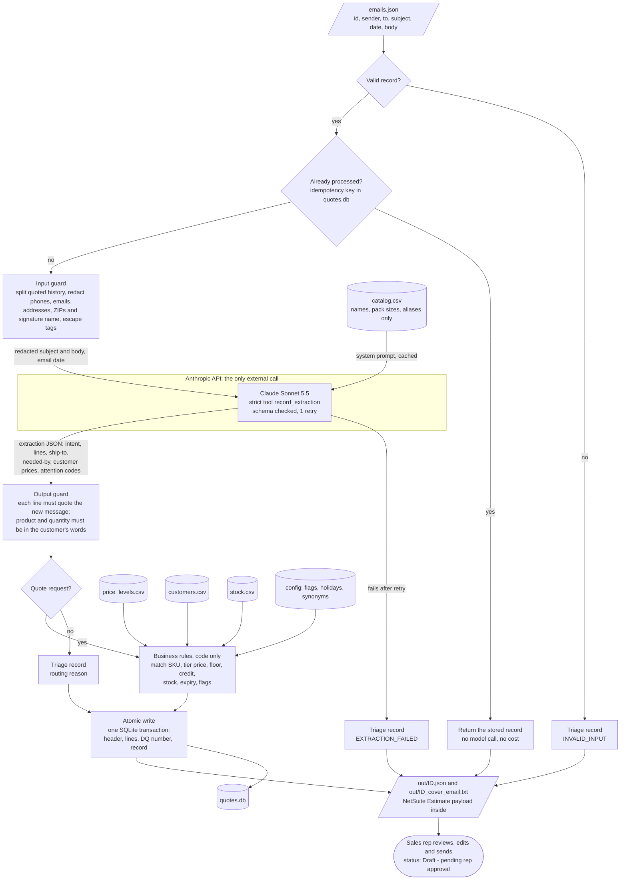
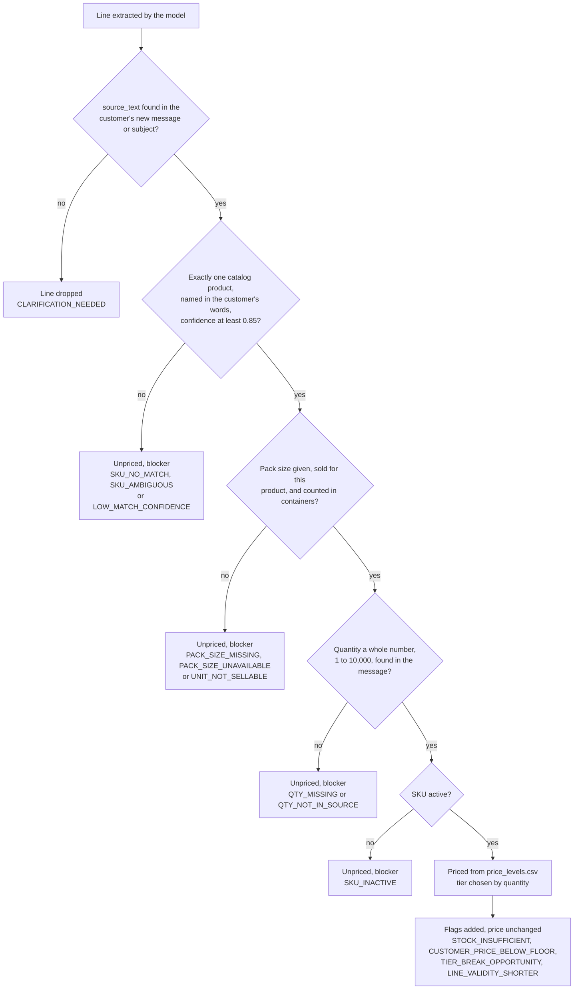

# Architecture

## End to end

Everything runs locally except one call to the Anthropic API. That call receives redacted email text and catalog names, nothing else.

What the model never receives: the sender address, the customer record, prices, floors, tiers, stock, credit limits, balances or terms. The extraction schema has no price field, so model output cannot reach a price.

## When a line gets a price

A line is priced only if it passes every check below. A line can collect several blockers; any blocker leaves it unpriced, with candidate SKUs listed for the rep. Warnings and info flags never change the price.

## Where each part lives

| Step | Code |
|---|---|
| Command line, run summary | `run.py` |
| Validation, duplicate check, orchestration, triage records | `agent/pipeline.py` |
| Input guard (quoted history, redaction, tag escaping) | `agent/redact.py` |
| Model call, retries, schema validation, cost | `agent/extract.py`, `prompts/` |
| Product matching and confidence | `agent/matching.py` |
| Tier pricing, floor, customer price requests | `agent/pricing.py` |
| Output guard, flags, credit, stock, dates, NetSuite payload | `agent/rules.py` |
| SQLite store, idempotency, quote numbers | `agent/store.py` |
| Rep notes and draft customer email (template) | `agent/cover_email.py` |
| Flag codes and severities | `config/flags.json` |
